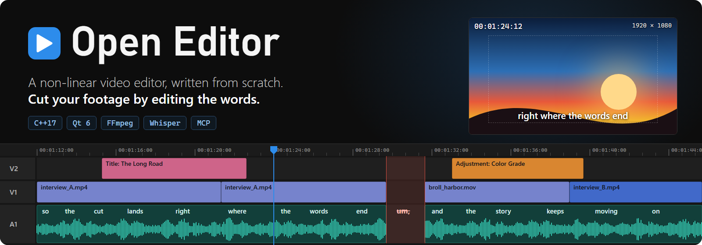
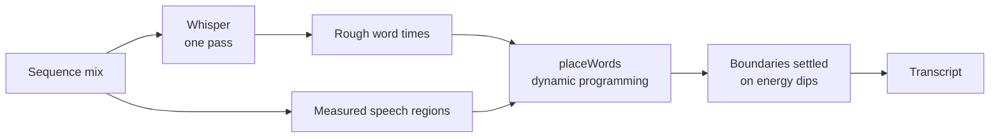
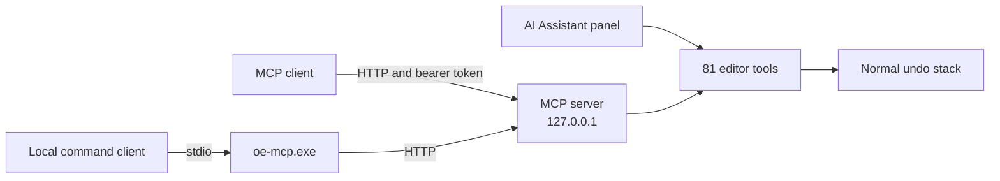
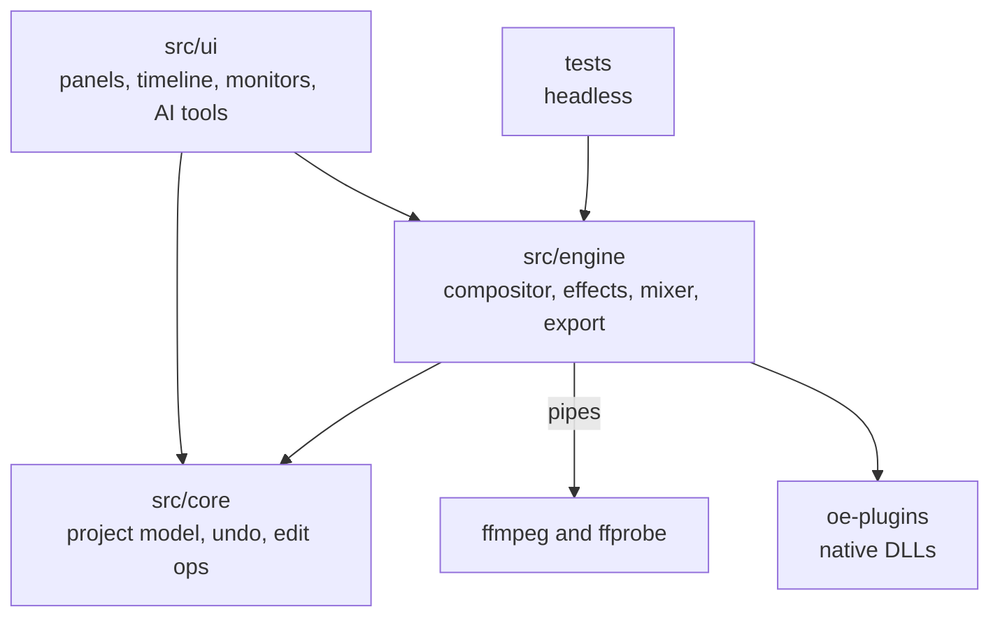

<div align="center">



<br>

**A non-linear video editor written from scratch in C++ with Qt 6 Widgets.**<br>
Timeline editing, color, audio and local speech-to-text, plus an MCP server that lets AI clients drive the editor.

<br>

[](LICENSE)


[Features](#features) ·
[Getting started](#getting-started) ·
[Text-based editing](#text-based-editing) ·
[AI](#ai) ·
[Plugins](#plugins) ·
[Architecture](#architecture) ·
[Testing](#testing) ·
[License](#license)

</div>

<table align="center">
  <tr>
    <td align="center"><b>91</b><br><sub>video and audio effects</sub></td>
    <td align="center"><b>26</b><br><sub>transitions</sub></td>
    <td align="center"><b>13</b><br><sub>blend modes</sub></td>
    <td align="center"><b>18+</b><br><sub>export formats</sub></td>
    <td align="center"><b>8</b><br><sub>workspaces</sub></td>
    <td align="center"><b>81</b><br><sub>MCP tools</sub></td>
  </tr>
</table>

## Features

| | |
| --- | --- |
| **Editing** | Multi-track timeline with razor, ripple delete, trim to playhead, linked clips, nested sequences, markers, and paste attributes |
| **Text-based editing** | Local Whisper transcription. Delete a word in the transcript and the footage goes with it, on every track |
| **Multicam** | Each video track is a camera angle, with a multicam viewer for cutting between them |
| **Color** | Color Grade with temperature, tone, lift, gamma, gain and vignette controls, plus LUTs and luma and RGB parade waveforms, vectorscope and histogram |
| **Compositing** | Keyframes with linear, hold and ease interpolation, 13 blend modes, chroma and luma keys, adjustment layers, titles |
| **Audio** | Track mixer and meters, clip and track effects, three crossfades, loudness normalization |
| **Performance** | GPU effects checked against CPU output, proxies, PQ and HLG sources tone mapped to Rec.709 |
| **AI** | MCP server, in-app Claude assistant, silence removal, scene edit detection |
| **Extensible** | Native C plugin API for video and audio effects |

<details>
<summary><b>All effects and transitions</b></summary>

<br>

| Category | Included |
| --- | --- |
| Adjust | Brightness & Contrast, Levels, Shadow/Highlight, Exposure, Tint |
| Color Correction | Color Grade, Hue/Saturation, Color Balance, Black & White, Sepia |
| Blur & Sharpen | Gaussian Blur, Directional Blur, Sharpen |
| Stylize | Glow, Mosaic, Posterize, Vignette, Noise, Drop Shadow, Invert |
| Transform & Distort | Crop, Horizontal Flip, Vertical Flip, Mirror, Wave Warp, Lens Distortion |
| Keying | Chroma Key, Luma Key |
| Time | Time Remapping |
| Audio dynamics | Amplify, Dynamics Compressor, Hard Limiter |
| Audio filters | High-Pass, Low-Pass, 3-Band Parametric EQ |
| Audio space | Delay, Studio Reverb |
| Audio utility | Invert Polarity, Swap Channels, Fill Stereo From Left |
| Video transitions | Cross, Film and Additive Dissolve, Dip to Black, Dip to White, Wipe, Wipe Down, Barn Doors, Clock Wipe, Iris Round, Iris Box, Iris Diamond, Push, Slide, Cross Zoom |
| Audio transitions | Constant Power, Constant Gain, Exponential Fade |

</details>

<details>
<summary><b>Export formats</b></summary>

<br>

| Type | Formats |
| --- | --- |
| Delivery | H.264, HEVC (H.265), VP9 (WebM), AV1 |
| Mastering | ProRes 422, ProRes 4444, DNxHR HQ |
| Hardware | H.264 and HEVC with NVIDIA NVENC, H.264 with Intel Quick Sync, H.264 with AMD AMF (listed when the encoder works on your machine) |
| Audio only | WAV, MP3, AAC |
| Other | Animated GIF |

</details>

## New in 3.0.0

| | |
| --- | --- |
| **Nothing gets lost** | Saves are written through a temporary file, so a crash or full disk mid-save leaves the old project intact, and the previous save is kept as `.oep.bak`. Auto-save keeps timestamped versions (every 3 minutes, 20 per project by default) that **File > Restore Version** brings back. While there are unsaved changes a recovery file is kept up to date, and after a crash or power cut the editor offers that work back at the next start. A damaged project file offers the newest version that still opens. Crashes leave a report and a minidump |
| **Media management** | **Link Media** finds moved files by name and size, **Project Manager** collects a project and its media into one folder, plus **Remove Unused Media** and a **Project Report** |
| **Editing** | Close All Gaps, Duplicate, Replace With Clip, Extend Edit to Playhead, Fade In/Out, layout presets (fill, fit, picture-in-picture, split screen), Auto Reframe to another aspect ratio, Match Frame, Select Clips at Playhead, Ease In and Ease Out keyframes, Save a Copy and Save Incremental |
| **Video effects** | Unsharp Mask, Radial Blur, Tilt-Shift, Film Grain, Chromatic Aberration, Glitch, Scanlines, Halftone, Threshold, Solarize, Gradient Map, HSL Secondary, Change to Color, Letterbox, Shape Mask, Kaleidoscope, Camera Shake, Timecode |
| **Transitions** | Wipe Up, Diagonal Wipe, Venetian Blinds, Checker Wipe, Push Up, Zoom In, Spin Away, Blur Dissolve |
| **Audio effects** | 10-band Graphic Equalizer, Bass, Treble, Notch, Bandpass, Multiband Compressor, Stereo Expander, Center Channel Extractor, Channel Volume, Tremolo, Auto-Pan, Phaser, Distortion, Bit Crusher, Voice Changer, Pitch Shifter |
| **Music** | Beat detection puts markers on the beats so cuts can snap to them |
| **Export** | A render queue that keeps rendering while you edit, your own presets, chapters from markers, PNG and JPEG sequences, FLAC, Opus, 24-bit WAV and MKV, CMX3600 EDL, marker lists as CSV or YouTube chapters. A stopped or failed export never replaces the file from last time |

Auto-save versions, recovery files and crash reports live in the app data folder (`%APPDATA%\Open Editor\Open Editor`), under `AutoSave`, `Sessions` and `Crashes`. The settings are in **Edit > Preferences > Auto Save**.

## Getting started

### Requirements

| Dependency | Version | Notes |
| --- | --- | --- |
| Qt | 6.10 or newer | Core, Gui, Widgets, Concurrent, Multimedia, Svg, OpenGL, Network, HttpServer. Developed with 6.11.1 MinGW 64-bit |
| CMake | 3.21 or newer | |
| Compiler | C++17 | Developed with the MinGW toolchain that ships with Qt |
| FFmpeg | 8 or newer | Must include the `whisper` filter. Needed at runtime |

> [!IMPORTANT]
> `ffmpeg` and `ffprobe` must be on `PATH`, or `ffmpeg.exe` and `ffprobe.exe` must sit beside `OpenEditor.exe`.

### Build and run

**Qt Creator:** open `CMakeLists.txt` with the *Desktop Qt 6.11.1 MinGW 64-bit* kit and run `appOpen_Editor`.

**Command line:** `build.sh` runs in Git Bash, MSYS2, Cygwin or WSL, from any folder. From PowerShell or cmd, use `build.cmd` with the same options. It runs `build.sh` through Git Bash, which avoids the WSL `bash` that PowerShell usually finds first.

```sh
./build.sh                  # everything (Release, build/ninja-release)
./build.sh oe_engine_test   # one target
./build.sh --test           # build, then run the headless test suites
./build.sh --debug          # Debug build in build/ninja-debug
./build.sh --clean          # delete the build folder and build from scratch
./build.sh --reconfigure    # run CMake again, e.g. after installing a new Qt
./build.sh -j 4 --verbose   # 4 jobs at once, show every compiler command
./build.sh --help           # all options
```

```powershell
.\build.cmd --test          # the same from PowerShell or cmd
```

> [!NOTE]
> `build.sh` finds the newest Qt 6 MinGW kit in `C:/Qt` or `D:/Qt`, and uses the MinGW, CMake and Ninja that come with it. Set environment variables to use others:
>
> - `QT_DIR` for the kit, e.g. `QT_DIR=C:/Qt/6.11.1/mingw_64 ./build.sh`
> - `QT_ROOT` for a different Qt folder
> - `MINGW_DIR`, `CMAKE` or `NINJA` for the tools
>
> If the project folder moves or the compiler is upgraded, the script configures again by itself. When a build fails, it tells you whether `OpenEditor.exe` is still running, since Windows won't let a running program be rebuilt.

Project files are JSON with the `.oep` extension.

## Text-based editing

The **Text** workspace transcribes the sequence on your computer with Whisper. The default model is Large v3 Turbo. Models download once, after you confirm, into the app data folder.

In the Transcript tab:

- **Click a word** to jump to it.
- **Select words and press Delete** to cut that footage from every track.

Captions, markers and links follow the edit, and Undo restores it all.

<details>
<summary><b>How word timing works</b></summary>

<br>

The mix goes to Whisper in one pass with word timestamps. Do not slice it with a short queue or VAD: that makes Whisper re-detect the language for each slice and costs accuracy and speed.

Whisper word times are only a guide, about 300 ms off. So `placeWords` assigns words to measured speech regions by dynamic programming and settles boundaries on energy dips.



Measure changes with `oe_align_eval`, which scores word starts against ground truth. Do not judge timing by eye on one clip.

</details>

## AI



### MCP server

Turn it on under **AI > MCP Server**. It is off by default.

- Streamable HTTP on `127.0.0.1`, port `8765` unless you change it
- Bearer token required, cross-origin requests refused
- Tools cover project and media, timeline edits, effects, captions, transcription, multicam, frames and export

`oe-mcp.exe` is a stdio bridge for clients that launch a local command. It finds the running editor by itself, so the client only needs its path:

```json
{
  "mcpServers": {
    "open-editor": {
      "command": "C:/path/to/oe-mcp.exe"
    }
  }
}
```

### AI Assistant

A chat panel that drives the same tools through the Claude Messages API, using your own API key, which is encrypted for your Windows user.

> [!WARNING]
> Project details, transcripts and any frames the assistant inspects are sent to the API.

All AI edits go through normal undo. The AI menu also has remove silence, scene edit detection and audio normalization.

## Plugins

Native effect plugins go in `oe-plugins` beside the executable or in the app data `plugins` folder. The API is a small C header: `src/plugin_api/oe_plugin.h`.

| | Video | Audio |
| --- | --- | --- |
| **Format** | BGRA8 premultiplied, in place | Interleaved stereo float, 48 kHz |
| **Parameters** | Evaluated at the current frame | Evaluated at the current frame |
| **Threads** | Called from render threads, keep it re-entrant | Per-clip `state` pointer |

See [`examples/plugin_duotone`](examples/plugin_duotone) for a complete plugin.

> [!CAUTION]
> Plugins run inside the editor process, so install only ones you trust.

## Architecture



The engine has no widgets, so the app and the headless tests share it through the `oe_core` library.

| Path | Contents |
| --- | --- |
| `src/core` | Value-type project model, undo, edit operations, media probing and caches |
| `src/engine` | ffmpeg pipes, frame reader, compositor, CPU and GPU effects, mixer, playback, export, analysis, plugin host |
| `src/ui` | Docking panels, timeline, monitors, grading, audio, transcript, AI tools, MCP server, assistant |
| `src/ui/icons` | Tabler Icons plus small UI glyphs |
| `src/plugin_api` | Public plugin header |
| `examples` | Example effect plugin |
| `tests` | Engine, feature and alignment test programs |
| `tools` | `oe-mcp` stdio bridge |

## Testing

| Test | Covers |
| --- | --- |
| `oe_engine_test` | Frame accuracy, edit operations, compositing, mixing, every effect, transition and export format |
| `oe_features_test` | GPU against CPU output, HDR, proxies, time remap, multicam, captions, automation, plugins, analysis |
| `oe_v3_test` | Atomic saves, backups, versions, a real crash in a child process and its recovery, media management, the 3.0 edit operations, every 3.0 effect and transition measured, beat detection, EDL and chapters, the new export formats |
| `OpenEditor --v3-test <outdir>` | The 3.0 features in the real window: auto-save, a second editor crashed on purpose and recovered, relinking, every new tool, the render queue |
| `OpenEditor --ui-smoke <outdir> <media...>` | Real mouse events through every tool, undo, save/load, docking, playback |
| `OpenEditor --text-test <outdir> <model> <media> <expected phrases...>` | Transcribe, then delete words with the real key |
| `OpenEditor --ai-test <outdir>` | MCP over real HTTP, token and origin checks, stdio bridge, assistant loop against a local mock |

The five headless suites (engine, features, v2, text, v3) are registered with CTest. `./build.sh --test` builds them and runs them all, or run CTest directly:

```sh
ctest --test-dir build/ninja-release --output-on-failure
```

## License

Open Editor is released under the [MIT License](LICENSE).

| Third-party | Used for | License |
| --- | --- | --- |
| [Qt 6](https://www.qt.io/) | Application framework | Most modules LGPLv3. **Qt HTTP Server is GPLv3 or commercial** |
| [FFmpeg](https://ffmpeg.org/) | Decode, encode, Whisper filter (separate program) | Depends on your build |
| [Tabler Icons](https://tabler.io/icons) | UI icons | MIT, see `src/ui/icons/LICENSE-tabler.txt` |

> [!NOTE]
> The MIT License covers this source code. A distributed binary links Qt HTTP Server, so it must also meet that module's license terms.
